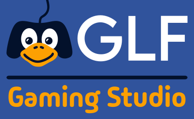
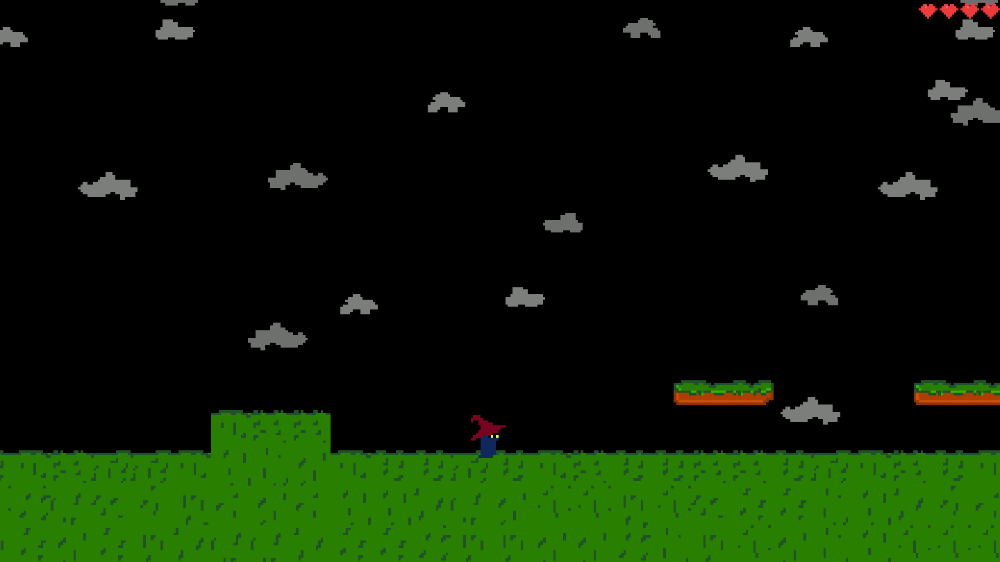
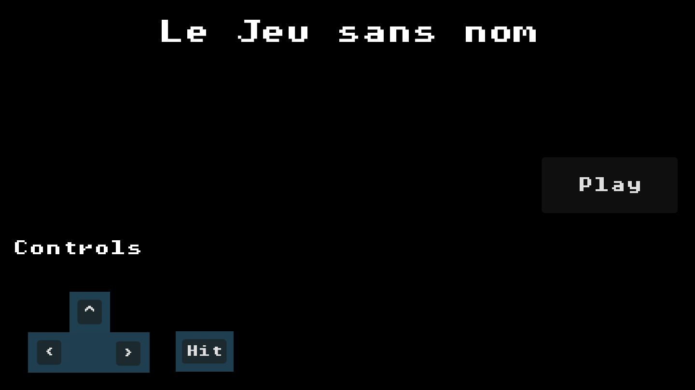

<p align="center">
  
</p>

<h1 align="center">Le Jeu sans nom</h1>

<p align="center">
  Un jeu de plateforme libre, écrit ensemble par la communauté <strong>Gaming Linux FR</strong>.
</p>

<p align="center">
  <a href="https://dupot-org.itch.io/glf-sans-nom"><strong>▶ Jouer dans le navigateur (itch.io)</strong></a>
</p>

---

## Le projet

**Le Jeu sans nom** est un projet communautaire : l'idée est de créer, à plusieurs et en open source, un petit jeu de plateforme 2D en pixel art, développé sous Linux avec [Godot](https://godotengine.org/).

Le jeu n'a pas encore de nom (d'où son titre provisoire 😄). Comme tout le reste, le nom sera choisi par la communauté.

Il n'y a pas besoin d'être développeur pour participer. On cherche aussi des graphistes, des musiciens, des level designers, des testeurs et des gens qui ont des idées.

<p align="center">
  
</p>

## Le jeu

Vous incarnez un petit sorcier au chapeau rouge qui parcourt des niveaux de plateforme. Il ramasse des objets magiques et s'en sert pour se débarrasser des ennemis, comme les champignons.

Ce qui est déjà en place :

- les déplacements et le saut du héros, au clavier
- plusieurs pouvoirs magiques à sélectionner : bâton, gel et boule de feu
- des objets à ramasser (pouvoirs magiques, pastèque…)
- un premier ennemi, le champignon, qui peut être touché et éliminé
- un système de points de vie avec affichage des cœurs (HUD)
- un écran titre qui rappelle les commandes, et un écran de game over

<p align="center">
  
</p>

### Commandes par défaut

| Action                  | Clavier                    |
| ----------------------- | -------------------------- |
| Aller à gauche / droite | `A` / `D` ou `←` / `→` (`Q` / `D` sur un clavier AZERTY) |
| Sauter                  | `Espace`                   |
| Utiliser la magie       | `E` ou `Tab`               |
| Choisir le bâton        | `1`                        |
| Choisir le gel          | `2`                        |
| Choisir le feu          | `3`                        |

## Tester le jeu

- **En ligne** : la dernière version est jouable sur [itch.io](https://dupot-org.itch.io/glf-sans-nom).
- **Sous Linux** : un export est disponible dans [game/jeuglfsansnom/export/Linux/](game/jeuglfsansnom/export/Linux/). Lancez `index.x86_64`.
- **Depuis les sources** : installez [Godot 4.7](https://godotengine.org/download/linux/), puis ouvrez le fichier [game/jeuglfsansnom/project.godot](game/jeuglfsansnom/project.godot) dans l'éditeur et appuyez sur `F5`.

## Organisation du dépôt

```
.
├── assets/                  # Fichiers sources des graphismes et des sons
│   ├── graphism/
│   │   ├── fonts/           # Police Pixel Operator
│   │   ├── platform/        # Personnages, ennemis, décors, HUD (fichiers Krita .kra)
│   │   └── screens/         # Logo et éléments des écrans
│   └── sounds/
├── docs/                    # Documents de conception (level design, présentation du héros…)
└── game/jeuglfsansnom/      # Le projet Godot
    ├── Game/
    │   ├── Actors/          # Joueur, ennemis et leurs machines à états
    │   ├── Levels/          # Les niveaux
    │   └── Shared/          # Éléments communs (HUD…)
    ├── Screens/             # Écrans de démarrage, menu, game over
    ├── Input/               # Gestion des contrôles
    └── export/              # Builds Linux et HTML5
```

Les graphismes sont réalisés avec [Krita](https://krita.org/) : les fichiers `.kra` sont dans `assets/`, et les images exportées sont utilisées par le projet Godot.

## Participer

Toutes les contributions sont les bienvenues, petites ou grandes :

- 🎨 **Graphismes** : sprites, décors, animations, interface
- 🎵 **Son** : musiques et bruitages (le dossier `assets/sounds/` attend vos créations !)
- 🗺️ **Level design** : imaginer et construire de nouveaux niveaux
- 💻 **Code** : nouvelles mécaniques, ennemis, corrections de bugs
- 🧪 **Tests et idées** : jouer, signaler les problèmes, proposer des améliorations, et pourquoi pas un nom pour le jeu

Pour proposer une contribution :

1. Forkez le dépôt et créez une branche (`git checkout -b feature/ma-contribution`).
2. Faites vos modifications, puis vérifiez dans Godot que le jeu se lance toujours.
3. Ouvrez une *pull request* qui explique ce que vous avez changé.

Pour une idée ou un bug, ouvrez simplement une [issue](https://github.com/imikado/glf-platform-game/issues). Vous pouvez aussi en parler directement avec la communauté Gaming Linux FR.

## Crédits

- Développé par la communauté **Gaming Linux FR** et ses contributeurs
- Moteur : [Godot Engine](https://godotengine.org/)
- Police : [Pixel Operator](https://fontlibrary.org/fr/font/pixel-operator)

## Licence

Ce projet est distribué sous licence **GNU GPL v3**. Voir le fichier [LICENSE](LICENSE).
